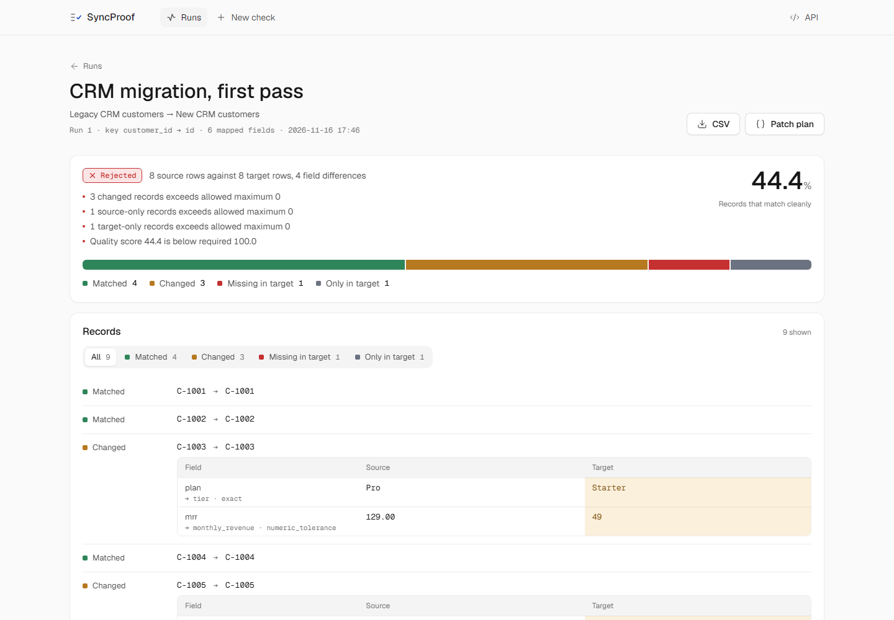
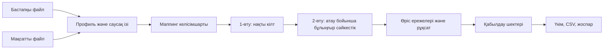
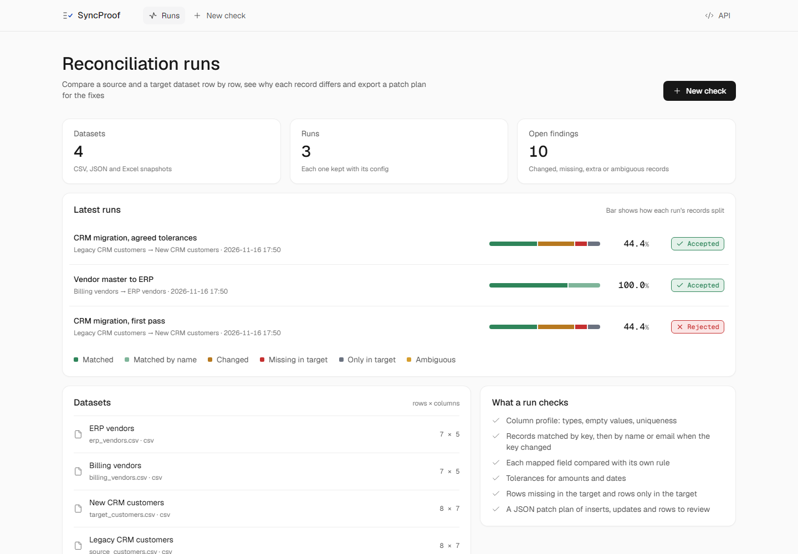
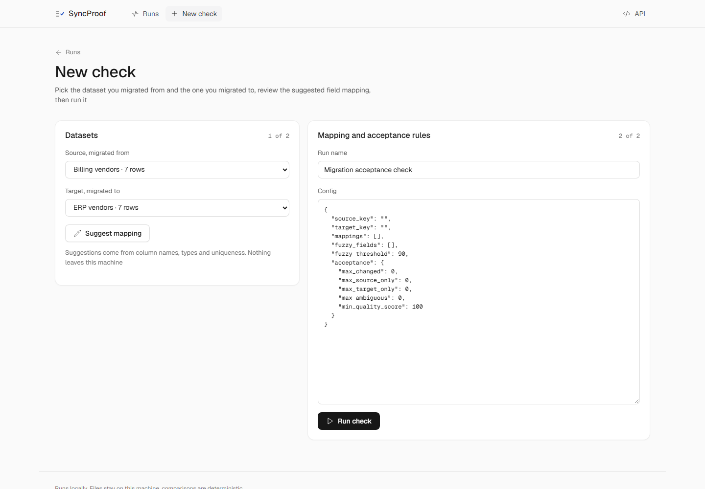
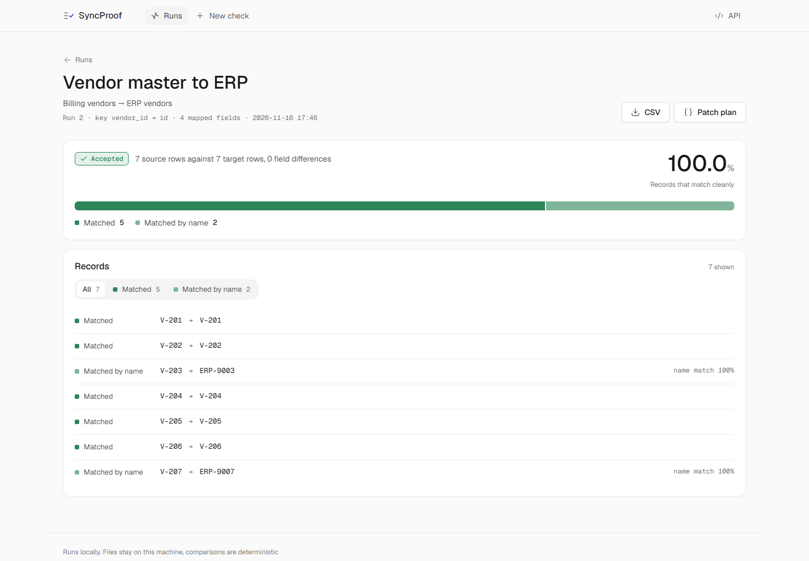

<div align="center">

# SyncProof

**Деректерді көшіру дұрыс жазбаларды және дұрыс мәндерді тасығанын дәлелдеңіз, жай ғана жолдар санын емес.**

[English](README.md) · [Русский](README.ru.md) · [Қазақша](README.kk.md)


</div>

<p align="center">
  
</p>

## Не істейді

Көшіру екі жақта да 100 000 жолмен аяқталып, бәрібір қате болуы мүмкін. Тариф төмендеп кеткен, бағаның тиыны жоғалған, ID пішімі өзгерген, бір жазба жоғалып, екіншісі бос жерден пайда болған.

SyncProof көшірілген деректі және көшірілген жерді алады, жазбаларды сәйкестендіреді, өрістер бойынша салыстырады және алдын ала белгіленген ережелер бойынша үкім шығарады. Әр табылған нәрсенің дәлелі беріледі. Бәрі сіздің компьютеріңізде жұмыс істейді, клиент деректері сыртқа шықпайды.

| Сіз бересіз | Сіз аласыз |
|---|---|
| Екі файл: CSV, JSON, XLSX немесе XLSM | Үкім: **Accepted** немесе **Rejected**, себептерімен |
| Маппинг: қай өріс неге айналды | Сапа бағасы және әр жазба бойынша нәтиже |
| Қабылдау шектері, мысалы «өзгерген жазба нөл» | Өрістер бойынша айырмашылық: бастапқы мән, мақсатты мән және іске қосылған ереже |
| | Табылғандардың CSV файлы және JSON түзету жоспары |

## Тексеру қалай өтеді



Алдымен нақты кілті бар жазбалар алынады. Бұлыңғыр іздеу әлі ешкімге тиесілі емес жолдармен ғана жұмыс істейді, сондықтан болжам басқа кілттің жазбасын тартып ала алмайды. Екі үміткер шамамен бірдей балл жинаса, жол `ambiguous` деп белгіленіп, адамға қалдырылады.

## Нәтижелер

| Нәтиже | Мағынасы |
|---|---|
| `matched` | Кілт сәйкес, маппингтегі барлық өріс келіседі |
| `fuzzy_matched` | Кілт сәйкес емес, бірақ атау өрістері шектен жоғары сәйкес келді |
| `changed` | Жазба табылды, бірақ кемінде бір өріс ереже шегінен тыс айырмашылық берді |
| `source_only` | Бастапқыда бар, мақсатта жоқ |
| `target_only` | Мақсатта бар, бастапқыдан оған ештеңе меңземейді |
| `ambiguous` | Балы `ambiguity_delta` шегінде бірнеше үміткер бар |

## Скриншоттар

<table>
  <tr>
    <td width="50%"><br><sub>Іске қосулар, әрқайсысында үкім және баға</sub></td>
    <td width="50%"><br><sub>Жаңа тексеру: екі деректер жинағы және ұсынылған маппинг</sub></td>
  </tr>
  <tr>
    <td colspan="2"><br><sub>Қабылданған іске қосу: ERP-де екі жеткізушінің ID-і өзгерді, бірақ оларды атауы бойынша тапты</sub></td>
  </tr>
</table>

## Жылдам бастау

```bash
python -m venv .venv
source .venv/bin/activate        # Windows: .venv\Scripts\activate
pip install -r requirements.txt
python scripts/seed_demo.py      # 8 жолдық демо
# python scripts/seed_demo.py --realistic   # 1 200 клиент, төменде қараңыз
uvicorn app.main:app --reload
```

| Не | Мекенжай |
|---|---|
| Панель | `http://127.0.0.1:8000` |
| API құжаттамасы (OpenAPI) | `http://127.0.0.1:8000/docs` |
| Health | `http://127.0.0.1:8000/api/health` |

Шағын демо әдейі кемшілігі бар CRM көшіруі: тарифтер мен бағалар өзгерген, бір жазба жоқ, бір артық. Үкім **Rejected**.

### Шынайы көшіру

`--realistic` нағыз көшірулер қалдыратын ақаулары бар 1 200 клиентті жүктейді. Генератор детерминделген және әр ақаудың нақты санын `examples/realistic/expected.json` файлына жазады, сондықтан тесттер SyncProof-ты белгілі шындықпен салыстырады.

| Деректерге салынған | Саны | SyncProof хабарлайды |
|---|---|---|
| Тариф, баға немесе бастау күні өзгерген | 65 | `changed`, өріспен және екі мәнмен |
| Клиент ID-і қайта жазылған (`C-10042` болды `CUS-10042`) | 40 | `fuzzy_matched`, атауы мен email бойынша табылды |
| Жаңа жүйеде жоқ | 25 | `source_only` |
| Ескі жүйе жүктемесінде қайталанады | 3 | `source_only`, кілті `duplicate_source_keys` ішінде |
| Ауыстырудан кейін жасалған | 12 | `target_only` |
| Бас әріпті email, бос орынды аттар, `1.290,00` бағалар, `КК.АА.ЖЖЖЖ` күндер | көп | ештеңе: бұл пішімдеу, айырмашылық емес |

Қайта жасау: `python scripts/generate_realistic.py --rows 1200 --seed 42`.

Docker арқылы: `docker compose up --build`. Күй `./data` ішінде сақталады.

## Маппинг келісімшарты

Тексеру бір JSON құжатымен сипатталады. Оны git-те сақтауға, қарап шығуға және әр келесі көшіру үшін қайта қолдануға болады.

```json
{
  "source_key": "customer_id",
  "target_key": "id",
  "mappings": [
    {"source": "full_name",  "target": "name",            "rule": "text"},
    {"source": "email",      "target": "email_address",   "rule": "email"},
    {"source": "mrr",        "target": "monthly_revenue", "rule": "numeric_tolerance", "tolerance": 0.01},
    {"source": "start_date", "target": "activated_at",    "rule": "date"}
  ],
  "fuzzy_fields": [{"source": "full_name", "target": "name"}],
  "fuzzy_threshold": 90,
  "acceptance": {
    "max_changed": 0,
    "max_source_only": 0,
    "max_target_only": 0,
    "max_ambiguous": 0,
    "min_quality_score": 100
  }
}
```

| Ереже | Нені салыстырады |
|---|---|
| `exact` | Мәндерді сол күйінде |
| `text` | Шеттегі бос орындарсыз және регистрді ескермей мәтін |
| `email` | Мекенжайларды регистрді ескермей |
| `numeric` | Сандар: `1,234.50`, `1.234,50` және `1234.5` тең деп саналады |
| `numeric_tolerance` | `tolerance` шегіндегі сандар |
| `date` | ISO, `YYYY/MM/DD`, `MM/DD/YYYY` немесе `DD.MM.YYYY` пішіміндегі күндер, `tolerance` күнмен есептеледі |

**New check** беті бағандардың атауы, түрі және бірегейлігі бойынша маппинг ұсынады. Ұсыныс детерминделген, ештеңе ешқайда жіберілмейді.

## Түзету жоспары

SyncProof мақсатты жүйеге ештеңе жазбайды. Ол адам немесе басқа автоматтандыру тексеріп, қолдана алатын жоспар жасайды:

```json
{
  "operations": [
    {"operation": "insert",        "key": "C-1007", "payload": {"...": "..."}},
    {"operation": "update",        "key": "C-1003", "changes": {"tier": "Pro"}},
    {"operation": "review_delete", "key": "C-1010", "payload": {"...": "..."}},
    {"operation": "manual_review", "key": "C-1012"}
  ]
}
```

## Осы нұсқада жаңалары

| Не | Қазір қалай жұмыс істейді |
|---|---|
| Кілттер | Деректегідей көрсетіледі, сондықтан түзету жоспары нақты жолды көрсетеді |
| Сәйкестендіру реті | Алдымен нақты кілттер, содан кейін бұлыңғыр. Нәтиже жолдар ретіне тәуелді емес |
| Бос кілттер | Кілті жоқ жолдар бір-бірімен ешқашан сәйкестендірілмейді |
| Қайталанатын кілттер | Бастапқыда қайталанған кілт бір рет сәйкестендіріліп, `duplicate_source_keys` ішіне түседі |
| Сандар | `1.234,50` және `$1,200` сан ретінде оқылады |
| Жүктеу | Бүлінген файл түсінікті 400 жауабын береді және дискіде қалмайды |
| Тексерулер | Деректерде жоқ бағанды атайтын іске қосу бірден қабылданбайды |
| CSV экспорты | Формулаға ұқсас ұяшықтар залалсыздандырылады, файлды Excel-де қауіпсіз ашуға болады |
| Интерфейс | Салыстыру ведомосы: нәтиже жолағы, үкім мөрі, әр өзгеріс бойынша өрістер тізімі. Телефонда жұмыс істейді |

## API

| Әдіс | Жол | Мақсаты |
|---|---|---|
| `POST` | `/api/datasets` | Деректер жинағын жүктеу |
| `GET` | `/api/datasets` | SHA-256 іздері бар суреттер тізімі |
| `GET` | `/api/mappings/suggest` | Екі жинақ үшін маппинг ұсыну |
| `POST` | `/api/runs` | Салыстыруды іске қосу |
| `POST` | `/api/runs/from-json` | Бір JSON денесінен іске қосу |
| `GET` | `/api/runs/{id}` | Іске қосу бойынша толық дәлелдер |
| `GET` | `/api/runs/{id}/export.csv` | Табылғандар CSV түрінде |
| `GET` | `/api/runs/{id}/patch-plan.json` | Түзету жоспары |

## Жоба құрылымы

```text
app/
  main.py          маршруттар мен беттер
  matcher.py       екі өтуді сәйкестендіру, өріс ережелері, қабылдау шектері
  mapper.py        маппинг ұсыныстары
  profiler.py      жүктеу және схеманы профильдеу
  repository.py    SQLite-тағы жинақтар мен іске қосулар тарихы
  services.py      жүктеу, іске қосу, CSV экспорты, түзету жоспары
  templates/       интерфейс
  static/          стильдер
examples/          шағын демо және examples/realistic (1 200 клиент)
scripts/           демо жүктеу, шынайы деректер генераторы
docs/              архитектура жазбалары және есеп үлгісі
tests/             сәйкестендіру, профильдеу, API, беттер, шеткі жағдайлар
```

## Баптау

| Айнымалы | Әдепкі мән |
|---|---|
| `SYNCPROOF_DB_PATH` | `data/syncproof.db` |
| `SYNCPROOF_UPLOAD_DIR` | `data/uploads` |
| `SYNCPROOF_HOST` | `0.0.0.0` |
| `SYNCPROOF_PORT` | `8000` |

## Тесттер

```bash
pytest -q        # 27 тест, желісіз
```

GitHub Actions әр push сайын тесттерді іске қосады.

## Қайда қолданылады

CRM және ERP көшірулері, кестеден базаға импорт, API синхрондауын тексеру, ETL қабылдау, жеткізушілер мен клиенттер анықтамалықтары, көшіруге дейінгі және кейінгі аудит, клиентке тапсыру есептері.

---

<div align="center">

Авторы: **[Koncha Artyom](https://github.com/artyom129)** · MIT лицензиясы

</div>
