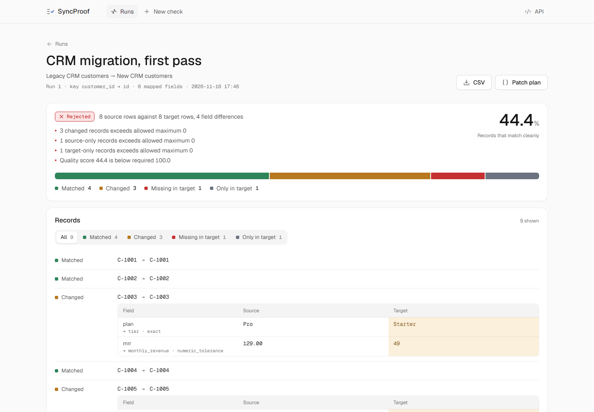
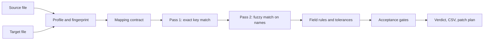
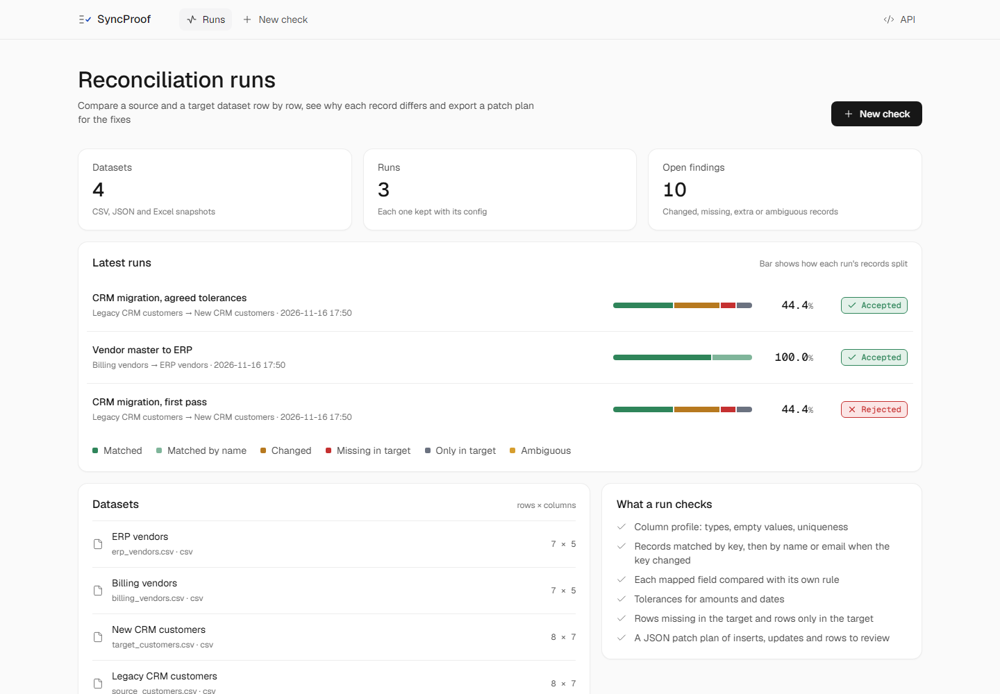
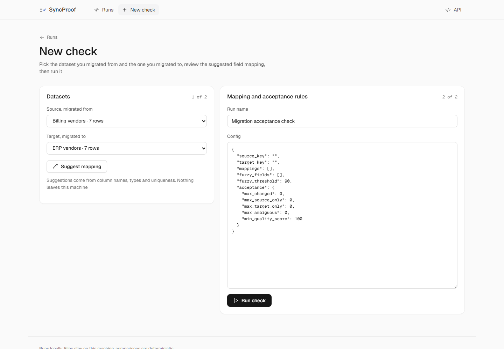
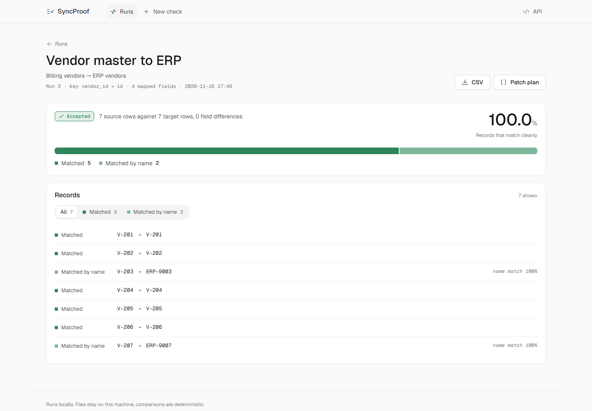

<div align="center">

# SyncProof

**Prove a data migration moved the right records and the right values, not just the right number of rows.**

[English](README.md) · [Русский](README.ru.md) · [Қазақша](README.kk.md)


</div>

<p align="center">
  
</p>

## What it does

A migration can end with 100,000 rows on both sides and still be wrong. A plan got downgraded, a price lost its decimals, an ID changed format, a row went missing and another one appeared from nowhere.

SyncProof takes the data you migrated from and the data you migrated to, matches the records, compares them field by field, and gives a verdict against rules you set in advance. Every finding comes with the evidence. Everything runs on your machine, so customer data never has to leave it.

| You give it | You get back |
|---|---|
| Two files: CSV, JSON, XLSX or XLSM | A verdict: **Accepted** or **Rejected**, with the reasons |
| A mapping: which field became which | A quality score and an outcome for every record |
| Acceptance limits, for example "zero changed records" | Field-level diffs: source value, target value, the rule that flagged it |
| | A CSV of findings and a JSON patch plan |

## How a check runs



Exact keys are claimed first. Fuzzy matching only works with rows nobody owns yet, so a guess can never steal a record that belongs to another key. When two candidates score too close to call, the row is marked `ambiguous` and left for a human.

## Outcomes

| Outcome | Meaning |
|---|---|
| `matched` | Same key, every mapped field agrees |
| `fuzzy_matched` | No key match, but the name fields match above the threshold |
| `changed` | Matched, but at least one field differs beyond its rule |
| `source_only` | In the source, missing in the target |
| `target_only` | In the target, nothing in the source points to it |
| `ambiguous` | Two or more candidates scored within `ambiguity_delta` of each other |

## Screenshots

<table>
  <tr>
    <td width="50%"><br><sub>Runs, each with its verdict and score</sub></td>
    <td width="50%"><br><sub>New check: pick two datasets, review the suggested mapping</sub></td>
  </tr>
  <tr>
    <td colspan="2"><br><sub>An accepted run: two vendors changed their IDs in the ERP and were still found by name</sub></td>
  </tr>
</table>

## Quick start

```bash
python -m venv .venv
source .venv/bin/activate        # Windows: .venv\Scripts\activate
pip install -r requirements.txt
python scripts/seed_demo.py      # the 8-row demo
# python scripts/seed_demo.py --realistic   # 1,200 customers, see below
uvicorn app.main:app --reload
```

| Where | URL |
|---|---|
| Dashboard | `http://127.0.0.1:8000` |
| API docs (OpenAPI) | `http://127.0.0.1:8000/docs` |
| Health | `http://127.0.0.1:8000/api/health` |

The small demo is a deliberately imperfect CRM migration: changed plans and prices, one missing record, one extra, so the verdict is **Rejected**.

### A realistic migration

`--realistic` loads 1,200 customers with the damage real migrations leave behind. The generator is deterministic and writes the exact number of every defect to `examples/realistic/expected.json`, so the tests hold SyncProof to a known truth.

| Planted in the data | Count | SyncProof reports |
|---|---|---|
| Plan, price or start date changed | 65 | `changed`, with the field and both values |
| Customer ID rewritten (`C-10042` became `CUS-10042`) | 40 | `fuzzy_matched`, found by name and email |
| Missing in the new system | 25 | `source_only` |
| Repeated in the legacy export | 3 | `source_only`, listed in `duplicate_source_keys` |
| Created after cut-over | 12 | `target_only` |
| Upper-case emails, padded names, `1.290,00` prices, `DD.MM.YYYY` dates | many | nothing, this is formatting, not a difference |

Regenerate with `python scripts/generate_realistic.py --rows 1200 --seed 42`.

With Docker: `docker compose up --build`. State lives in `./data`.

## The mapping contract

A check is described by one JSON document. It can live in git, be reviewed, and be reused for every future migration.

```json
{
  "source_key": "customer_id",
  "target_key": "id",
  "mappings": [
    {"source": "full_name",  "target": "name",            "rule": "text"},
    {"source": "email",      "target": "email_address",   "rule": "email"},
    {"source": "mrr",        "target": "monthly_revenue", "rule": "numeric_tolerance", "tolerance": 0.01},
    {"source": "start_date", "target": "activated_at",    "rule": "date"}
  ],
  "fuzzy_fields": [{"source": "full_name", "target": "name"}],
  "fuzzy_threshold": 90,
  "acceptance": {
    "max_changed": 0,
    "max_source_only": 0,
    "max_target_only": 0,
    "max_ambiguous": 0,
    "min_quality_score": 100
  }
}
```

| Rule | Compares |
|---|---|
| `exact` | Values as they are |
| `text` | Text after trimming and case folding |
| `email` | Addresses, case-insensitive |
| `numeric` | Numbers, so `1,234.50`, `1.234,50` and `1234.5` agree |
| `numeric_tolerance` | Numbers within `tolerance` |
| `date` | Dates in ISO, `YYYY/MM/DD`, `MM/DD/YYYY` or `DD.MM.YYYY`, with `tolerance` counted in days |

The **New check** page suggests a mapping from column names, types and uniqueness. The suggestion is deterministic, nothing is sent anywhere.

## Patch plan

SyncProof never writes to your target system. It produces a plan that a person or another automation can review and apply:

```json
{
  "operations": [
    {"operation": "insert",        "key": "C-1007", "payload": {"...": "..."}},
    {"operation": "update",        "key": "C-1003", "changes": {"tier": "Pro"}},
    {"operation": "review_delete", "key": "C-1010", "payload": {"...": "..."}},
    {"operation": "manual_review", "key": "C-1012"}
  ]
}
```

## What's new in this version

| What | How it works now |
|---|---|
| Keys | Shown exactly as they appear in your data, so a patch plan points at the real row |
| Matching order | Exact keys first, fuzzy second. The result does not depend on row order |
| Empty keys | Rows without a key are never matched to each other |
| Repeated keys | A key repeated in the source is matched once and listed under `duplicate_source_keys` |
| Numbers | `1.234,50` and `$1,200` are read as numbers |
| Uploads | A broken file returns a clear 400 and leaves nothing behind |
| Checks | A run that mentions a column missing from the data is rejected up front |
| CSV export | Cells that look like formulas are neutralised, so the file is safe to open in Excel |
| Interface | A reconciliation sheet: outcome bar, verdict stamp, a field ledger for every change. Works on a phone |

## API

| Method | Path | Purpose |
|---|---|---|
| `POST` | `/api/datasets` | Upload a dataset |
| `GET` | `/api/datasets` | List snapshots with their SHA-256 fingerprints |
| `GET` | `/api/mappings/suggest` | Suggest a mapping for two datasets |
| `POST` | `/api/runs` | Run a reconciliation |
| `POST` | `/api/runs/from-json` | Run from a single JSON body |
| `GET` | `/api/runs/{id}` | Full evidence for a run |
| `GET` | `/api/runs/{id}/export.csv` | Findings as CSV |
| `GET` | `/api/runs/{id}/patch-plan.json` | Corrective plan |

## Project layout

```text
app/
  main.py          routes and pages
  matcher.py       two-pass matching, field rules, acceptance gates
  mapper.py        mapping suggestions
  profiler.py      loading and schema profiling
  repository.py    SQLite history of datasets and runs
  services.py      ingestion, runs, CSV export, patch plan
  templates/       interface
  static/          styles
examples/          small demo and examples/realistic (1,200 customers)
scripts/           demo seeding, realistic data generator
docs/              architecture notes and a sample report
tests/             matching, profiling, API, pages, edge cases
```

## Configuration

| Variable | Default |
|---|---|
| `SYNCPROOF_DB_PATH` | `data/syncproof.db` |
| `SYNCPROOF_UPLOAD_DIR` | `data/uploads` |
| `SYNCPROOF_HOST` | `0.0.0.0` |
| `SYNCPROOF_PORT` | `8000` |

## Tests

```bash
pytest -q        # 27 tests, no network
```

GitHub Actions runs the suite on every push.

## Where it fits

CRM and ERP migrations, spreadsheet-to-database imports, API sync validation, ETL acceptance testing, vendor and customer master data, pre- and post-migration audits, and handoff reports for a client.

---

<div align="center">

Built by **[Koncha Artyom](https://github.com/artyom129)** · MIT License

</div>
