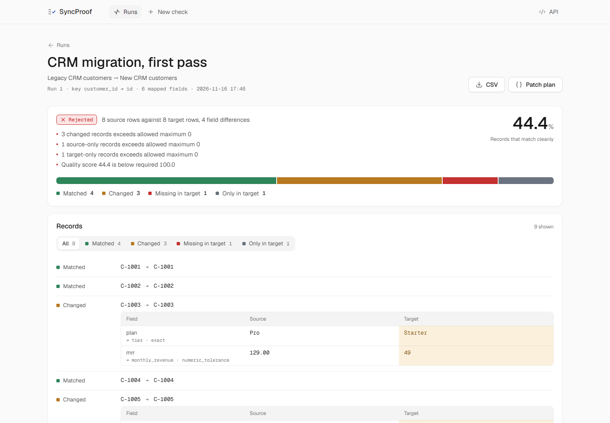
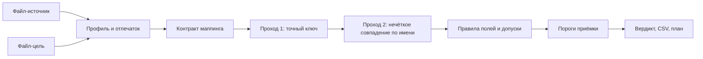
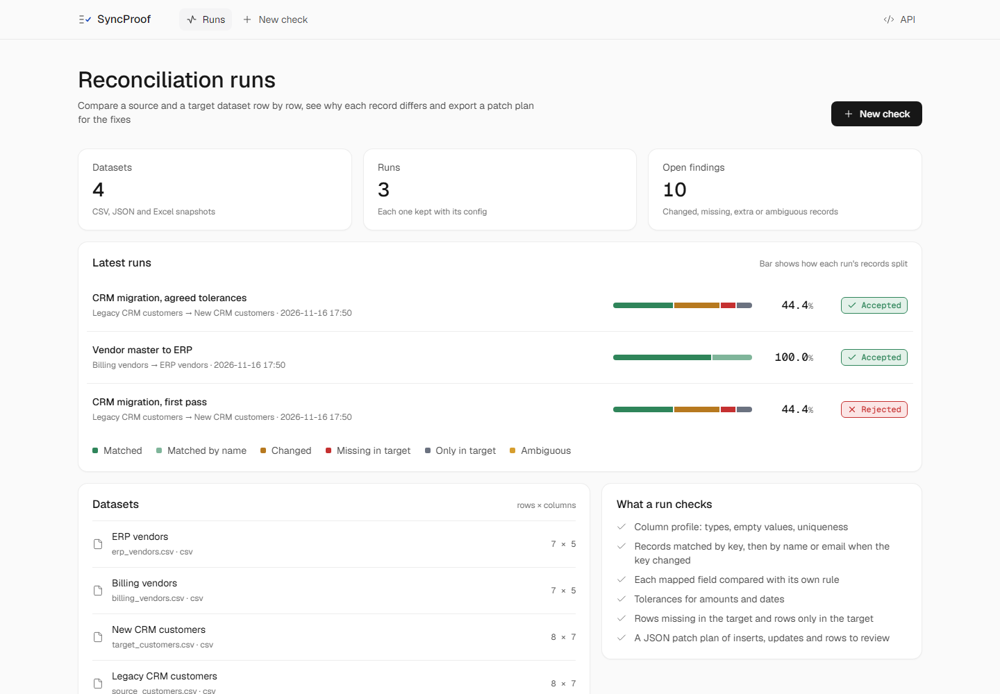
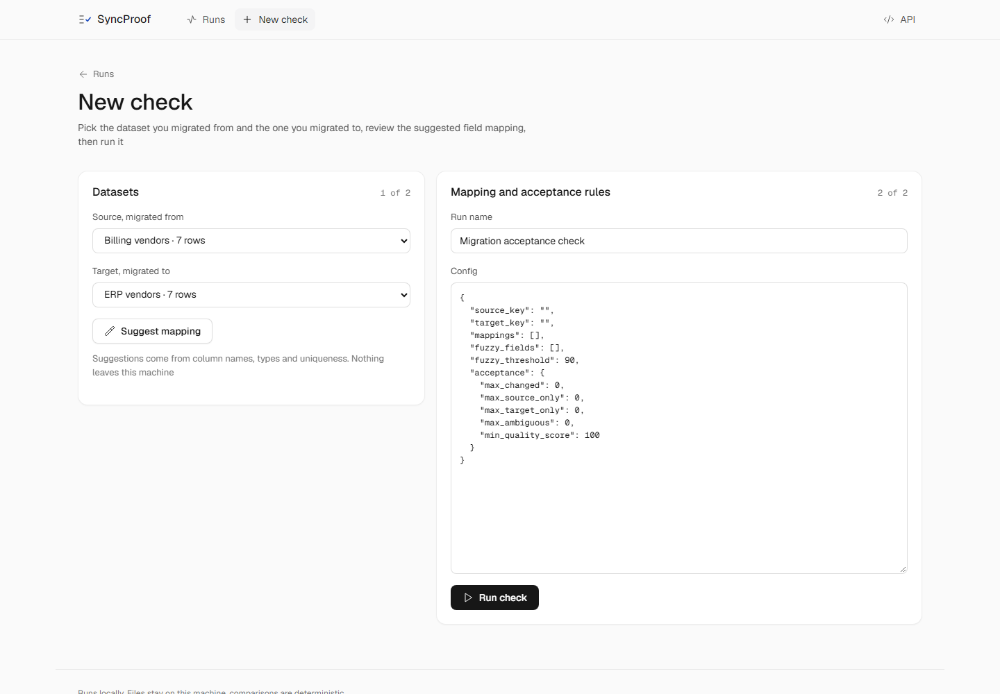
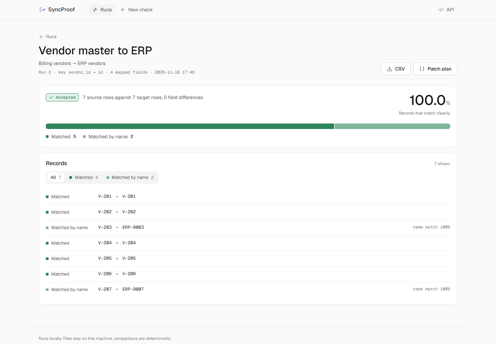

<div align="center">

# SyncProof

**Докажите, что миграция данных перенесла нужные записи и нужные значения, а не просто нужное число строк.**

[English](README.md) · [Русский](README.ru.md) · [Қазақша](README.kk.md)


</div>

<p align="center">
  
</p>

## Что это делает

Миграция может закончиться со 100 000 строк с обеих сторон и всё равно быть неверной. Тариф понизился, у цены пропали копейки, ID поменял формат, одна запись пропала, а другая появилась из ниоткуда.

SyncProof берёт данные, из которых вы переносили, и данные, в которые перенесли, сопоставляет записи, сравнивает их по полям и выносит вердикт по правилам, которые вы задали заранее. К каждой находке прилагаются доказательства. Всё работает на вашей машине, данные клиентов никуда не уходят.

| Вы даёте | Вы получаете |
|---|---|
| Два файла: CSV, JSON, XLSX или XLSM | Вердикт: **Accepted** или **Rejected**, с причинами |
| Маппинг: какое поле во что превратилось | Оценку качества и исход по каждой записи |
| Пределы приёмки, например «ноль изменённых записей» | Различия по полям: значение в источнике, в цели и правило, которое сработало |
| | CSV с находками и JSON-план исправлений |

## Как проходит проверка



Сначала занимаются записи с точным ключом. Нечёткий поиск работает только со строками, которые пока никому не принадлежат, поэтому догадка не может отнять запись у другого ключа. Если два кандидата набрали почти одинаково, строка помечается `ambiguous` и остаётся человеку.

## Исходы

| Исход | Что значит |
|---|---|
| `matched` | Ключ совпал, все поля маппинга согласны |
| `fuzzy_matched` | Ключ не совпал, но поля имени совпали выше порога |
| `changed` | Запись найдена, но хотя бы одно поле расходится сверх правила |
| `source_only` | Есть в источнике, нет в цели |
| `target_only` | Есть в цели, из источника на неё ничего не указывает |
| `ambiguous` | Несколько кандидатов с оценкой в пределах `ambiguity_delta` друг от друга |

## Скриншоты

<table>
  <tr>
    <td width="50%"><br><sub>Запуски, у каждого вердикт и оценка</sub></td>
    <td width="50%"><br><sub>Новая проверка: два набора данных и предложенный маппинг</sub></td>
  </tr>
  <tr>
    <td colspan="2"><br><sub>Принятый запуск: у двух поставщиков в ERP сменились ID, и их всё равно нашли по имени</sub></td>
  </tr>
</table>

## Быстрый старт

```bash
python -m venv .venv
source .venv/bin/activate        # Windows: .venv\Scripts\activate
pip install -r requirements.txt
python scripts/seed_demo.py      # демо на 8 строк
# python scripts/seed_demo.py --realistic   # 1 200 клиентов, см. ниже
uvicorn app.main:app --reload
```

| Что | Адрес |
|---|---|
| Панель | `http://127.0.0.1:8000` |
| Документация API (OpenAPI) | `http://127.0.0.1:8000/docs` |
| Health | `http://127.0.0.1:8000/api/health` |

Маленькое демо это намеренно неидеальная миграция CRM: изменились тарифы и цены, одна запись пропала, одна лишняя. Вердикт **Rejected**.

### Реалистичная миграция

`--realistic` загружает 1 200 клиентов с теми повреждениями, которые оставляют настоящие миграции. Генератор детерминированный и записывает точное число каждого дефекта в `examples/realistic/expected.json`, поэтому тесты сверяют SyncProof с известной правдой.

| Заложено в данные | Кол-во | SyncProof сообщает |
|---|---|---|
| Изменён тариф, цена или дата старта | 65 | `changed`, с полем и обоими значениями |
| ID клиента переписан (`C-10042` стал `CUS-10042`) | 40 | `fuzzy_matched`, найдено по имени и email |
| Нет в новой системе | 25 | `source_only` |
| Повторяются в выгрузке старой системы | 3 | `source_only`, ключ в `duplicate_source_keys` |
| Созданы после переключения | 12 | `target_only` |
| Email в верхнем регистре, пробелы в именах, цены `1.290,00`, даты `ДД.ММ.ГГГГ` | много | ничего: это форматирование, а не различие |

Пересоздать: `python scripts/generate_realistic.py --rows 1200 --seed 42`.

Через Docker: `docker compose up --build`. Состояние хранится в `./data`.

## Контракт маппинга

Проверка описывается одним JSON-документом. Его можно держать в git, ревьюить и использовать для каждой следующей миграции.

```json
{
  "source_key": "customer_id",
  "target_key": "id",
  "mappings": [
    {"source": "full_name",  "target": "name",            "rule": "text"},
    {"source": "email",      "target": "email_address",   "rule": "email"},
    {"source": "mrr",        "target": "monthly_revenue", "rule": "numeric_tolerance", "tolerance": 0.01},
    {"source": "start_date", "target": "activated_at",    "rule": "date"}
  ],
  "fuzzy_fields": [{"source": "full_name", "target": "name"}],
  "fuzzy_threshold": 90,
  "acceptance": {
    "max_changed": 0,
    "max_source_only": 0,
    "max_target_only": 0,
    "max_ambiguous": 0,
    "min_quality_score": 100
  }
}
```

| Правило | Что сравнивает |
|---|---|
| `exact` | Значения как есть |
| `text` | Текст без пробелов по краям и без учёта регистра |
| `email` | Адреса без учёта регистра |
| `numeric` | Числа: `1,234.50`, `1.234,50` и `1234.5` считаются равными |
| `numeric_tolerance` | Числа в пределах `tolerance` |
| `date` | Даты в формате ISO, `YYYY/MM/DD`, `MM/DD/YYYY` или `DD.MM.YYYY`, допуск `tolerance` в днях |

Страница **New check** предлагает маппинг по названиям колонок, типам и уникальности. Подсказка детерминированная, ничего никуда не отправляется.

## План исправлений

SyncProof ничего не пишет в целевую систему. Он готовит план, который человек или другая автоматизация может проверить и применить:

```json
{
  "operations": [
    {"operation": "insert",        "key": "C-1007", "payload": {"...": "..."}},
    {"operation": "update",        "key": "C-1003", "changes": {"tier": "Pro"}},
    {"operation": "review_delete", "key": "C-1010", "payload": {"...": "..."}},
    {"operation": "manual_review", "key": "C-1012"}
  ]
}
```

## Что нового в этой версии

| Что | Как теперь работает |
|---|---|
| Ключи | Показываются ровно так, как лежат в данных, поэтому план исправлений указывает на настоящую строку |
| Порядок сопоставления | Сначала точные ключи, потом нечёткие. Результат не зависит от порядка строк |
| Пустые ключи | Строки без ключа никогда не сопоставляются друг с другом |
| Повторяющиеся ключи | Ключ, повторённый в источнике, сопоставляется один раз и попадает в `duplicate_source_keys` |
| Числа | `1.234,50` и `$1,200` читаются как числа |
| Загрузка | Битый файл даёт понятный ответ 400 и не остаётся на диске |
| Проверки | Запуск с колонкой, которой нет в данных, отклоняется сразу |
| Экспорт CSV | Ячейки, похожие на формулы, обезвреживаются, файл безопасно открывать в Excel |
| Интерфейс | Сверочная ведомость: полоса исходов, штамп вердикта, построчный список изменений по полям. Работает на телефоне |

## API

| Метод | Путь | Назначение |
|---|---|---|
| `POST` | `/api/datasets` | Загрузить набор данных |
| `GET` | `/api/datasets` | Список снимков с отпечатками SHA-256 |
| `GET` | `/api/mappings/suggest` | Предложить маппинг для двух наборов |
| `POST` | `/api/runs` | Запустить сверку |
| `POST` | `/api/runs/from-json` | Запустить сверку из одного JSON-тела |
| `GET` | `/api/runs/{id}` | Все доказательства по запуску |
| `GET` | `/api/runs/{id}/export.csv` | Находки в CSV |
| `GET` | `/api/runs/{id}/patch-plan.json` | План исправлений |

## Структура проекта

```text
app/
  main.py          маршруты и страницы
  matcher.py       двухпроходное сопоставление, правила полей, пороги приёмки
  mapper.py        подсказки маппинга
  profiler.py      загрузка и профилирование схемы
  repository.py    история наборов и запусков в SQLite
  services.py      загрузка, запуски, экспорт CSV, план исправлений
  templates/       интерфейс
  static/          стили
examples/          малое демо и examples/realistic (1 200 клиентов)
scripts/           загрузка демо, генератор реалистичных данных
docs/              заметки об архитектуре и пример отчёта
tests/             сопоставление, профилирование, API, страницы, крайние случаи
```

## Настройка

| Переменная | По умолчанию |
|---|---|
| `SYNCPROOF_DB_PATH` | `data/syncproof.db` |
| `SYNCPROOF_UPLOAD_DIR` | `data/uploads` |
| `SYNCPROOF_HOST` | `0.0.0.0` |
| `SYNCPROOF_PORT` | `8000` |

## Тесты

```bash
pytest -q        # 27 тестов, без сети
```

GitHub Actions запускает набор при каждом пуше.

## Где применяется

Миграции CRM и ERP, импорт из таблиц в базу, проверка синхронизации по API, приёмка ETL, справочники поставщиков и клиентов, аудит до и после миграции, отчёты для передачи клиенту.

---

<div align="center">

Автор: **[Koncha Artyom](https://github.com/artyom129)** · Лицензия MIT

</div>
