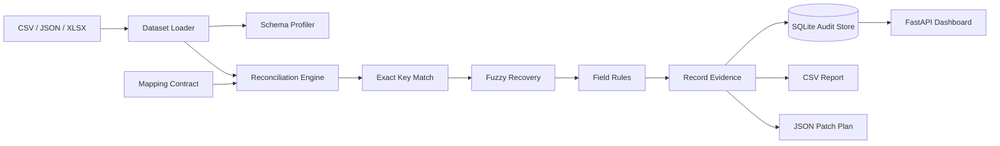

# Architecture

SyncProof separates dataset ingestion, profiling, comparison logic and persistence so the reconciliation engine can be reused outside the web UI.

The engine is deterministic: the same source snapshot, target snapshot and mapping contract produce the same reconciliation result.
